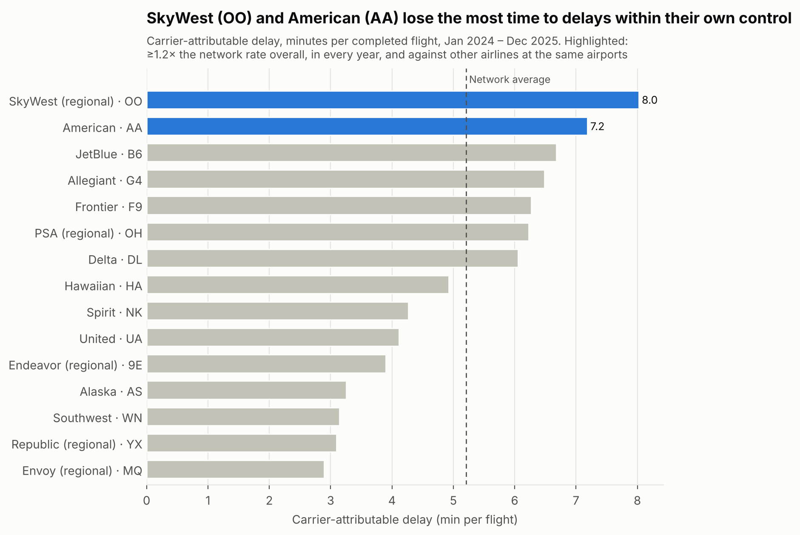
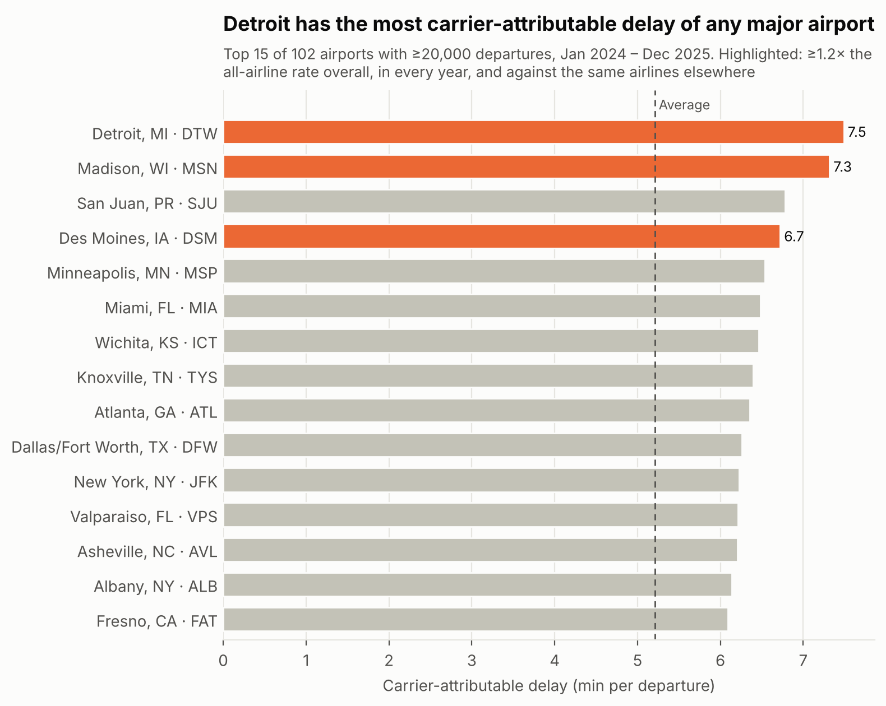
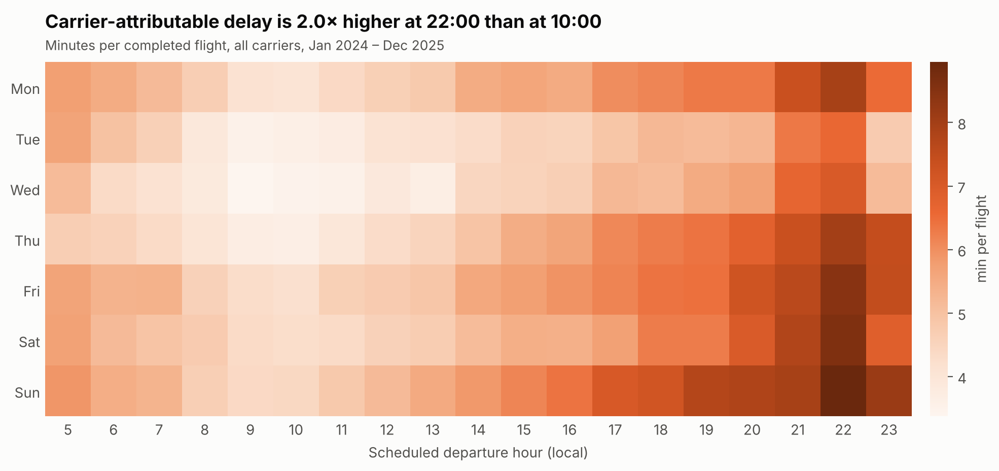

# Where airlines lose time

*Data analytics case study. Same content as `case_study.html`, for pasting into a portfolio site or CMS. Images are in `figures/`.*

*This analysis uses US DOT (BTS) flight data rather than Singapore data, since CAAS/data.gov.sg only publishes aggregate monthly figures for Changi, and no flight-level, cause-coded delay data is publicly available. BTS was chosen as the best available public dataset with the granularity needed for this kind of analysis.*

**13.8M** US domestic flights analysed (Jan 2024 – Dec 2025) · **1.3×** SkyWest and American's delay rate vs other airlines at the same airports · **20,600 h** delay a year recoverable by fixing their first flights of the day

## The problem

Airlines can't control the weather or air traffic. But a third of recorded delay minutes in US flying (33%) come from causes inside the airline's own operation: maintenance, crew, cleaning, fuelling and baggage. That's where management action actually pays off. The question: **which airports or carriers show disproportionately high carrier-attributable delay, and does time of day or day of week make it worse?**

## Approach

- **Data:** 14.1M flights from the US Bureau of Transportation Statistics, which records the cause of every delay of 15+ minutes. Cancelled and diverted flights are excluded from the delay measures.
- **Measure:** carrier-attributable delay minutes per flight. It's called *carrier-attributable*, not "mechanical", because BTS records maintenance in the same field as crew, cleaning and baggage.
- **"Disproportionate"** means at least 1.2× the network average in *each* year, and still that high when compared with other airlines at the same airports. That way no one is penalised just for flying from difficult airports.
- **Robustness:** re-run without the July 2024 CrowdStrike IT outage. SkyWest and American stay flagged; Frontier, just under the bar in 2024, also crosses it.

## What the data shows

### 1. Two carriers stand out

SkyWest (a regional airline flying for United, Delta, American and Alaska) averages 8.0 minutes of carrier-attributable delay per flight, and American 7.2, against a network average of 5.2. Both run at about 1.3× the rate of other airlines at the same airports, in 2024 and in 2025. They fail differently: SkyWest's delays are slightly rarer but nearly twice as long, and American's are more frequent.

### 2. Airports matter far less than airlines

Detroit, Madison and Des Moines are flagged, but together they account for about 5,600 excess delay hours a year. The two flagged carriers account for 68,100.

### 3. Timing makes it worse, and the first flights of the day are where the two carriers fall furthest behind

Across all airlines, carrier-attributable delay is twice as high at 22:00 as at 10:00, and Sunday is the worst day. But SkyWest and American lose the most ground *before 09:00*, when the rest of the network runs better than its daily average. There they run 1.76× and 1.51× the network rate.

## Recommendation

**Fix the first flights of the day at SkyWest and American.** Bringing their pre-09:00 departures down to the network's pre-09:00 rate would remove about **20,600 delay hours a year** (10,300 each). Likely places to look are overnight maintenance sign-off, crew turning up on time and getting aircraft ready at the airports where their first flights of the day leave from. The estimate is conservative, because a late first flight also delays later flights, and that knock-on delay isn't counted here.

## Limits

The data only records causes for delays of 15+ minutes. It can't tell maintenance apart from crew or cleaning, and airlines report the causes themselves. It covers US domestic flying only, so results may not carry over to other markets.

---

## Resume bullets

One number, one finding, one recommendation. Use one bullet, matched to the application.

**Management Associate / business roles**
> Analysed 13.8M US flights (US DOT data, 2024–25) to find which airlines lose the most time to delays within their own control; showed SkyWest and American run 1.3× peers at the same airports, worst before 09:00, and recommended fixing their first flights of the day, worth ~20,600 delay hours a year.

**Software / tech roles**
> Built a Python/pandas pipeline over 14M US DOT flight records with mix-adjusted benchmarking and year-by-year robustness checks; identified two airlines running 1.3× peers on carrier-caused delay and a first-flight-of-day fix worth ~20,600 delay hours a year, published as an auto-generated report.
